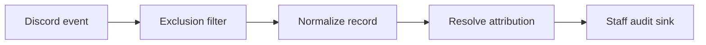

# Discord Audit Log Pipeline

**Event normalization and staff-facing accountability records**

  

> **Documentation-only portfolio case study.** The source under [`src/public_interface.py`](src/public_interface.py) is intentionally unimplemented and raises `NotImplementedError`. This is **not** a runnable bot, a deployment package or independently verified production evidence.

## Why this module exists

Discord can emit overlapping events for message changes, voice transitions, member changes and moderation actions. A useful audit pipeline must normalize different event shapes, attribute an actor only when supported and avoid flooding staff with misleading records.

**Technology context:** Python, discord.py listeners and Discord audit-log integrations. These technologies describe the private module's documented domain; public executable implementation is not provided.

## Workflow at a glance

1. Receive a Discord event from a configured listener
2. Apply channel, category and role exclusions
3. Attach event time, subject and the best available attribution context
4. Format a concise staff record without inventing an actor
5. Deliver to an authorized destination and record delivery failures

These stages summarize the public project description; the exact runtime and private integration details cannot be independently verified from the public skeleton.

## Engineering challenges

| Topic | Why it matters | How it should be verified |
|---|---|---|
| Actor attribution | Audit events may not provide a reliable responsible user | Test missing, delayed and ambiguous actor resolution |
| Privacy and scope | Edited messages and member activity can contain personal data | Enforce channel exclusions and retention policy |
| Delivery failure | Target log channel may be removed or lack permissions | Define failure reporting and retry limits |
| Event volume | Bursts can trigger API rate limits and noisy alerts | Batch or rate-limit safely without losing ordering |

## Component boundary

This diagram is **conceptual**, not a snapshot of private production architecture. See the [design notes](docs/ARCHITECTURE.md) for boundaries, failure scenarios and test ideas.

## Repository contents and status

- [`src/public_interface.py`](src/public_interface.py) — non-runnable, documented public interface skeleton
- [`docs/ARCHITECTURE.md`](docs/ARCHITECTURE.md) — engineering design notes (no operational secrets)
- [`examples/config.example.jsonc`](examples/config.example.jsonc) — illustrative configuration shape, **not** a production configuration
- [`NOTICE.md`](NOTICE.md) and [`SECURITY.md`](SECURITY.md) — publication/security boundary

**Portfolio role:** Module-level documentation for a private event/audit integration. No public tests, executable deployment or usage metrics are claimed here. For verifiable code, inspect the [FastAPI backend demo](https://github.com/Scumbagsss/priority-access-bot), [ticket workflow](https://github.com/Scumbagsss/advanced-discord-ticket-bot) and [monitoring pipeline](https://github.com/Scumbagsss/dayz-server-monitor-bot).

**Related systems:** [deadcity-admin-abuse-detector](https://github.com/Scumbagsss/deadcity-admin-abuse-detector) · [BOT](https://github.com/Scumbagsss/BOT).

**Contact:** Discord `scumbagsss` · Telegram [@dilarion](https://t.me/dilarion)
